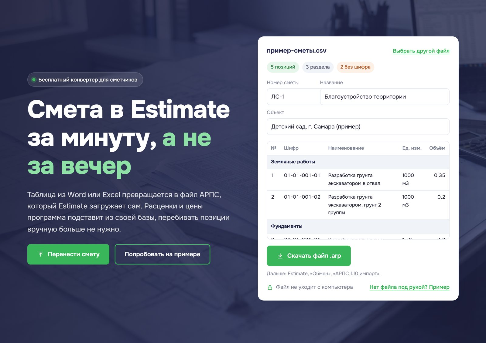

<p align="center">
  
</p>

<h1 align="center">Смета в АРПС</h1>

<p align="center">
  Бесплатный конвертер сметы из Word, Excel и CSV в файл <b>АРПС 1.10</b>,<br>
  который загружают Estimate и другие сметные программы.
</p>

<p align="center">
  <a href="#лицензия-mit"></a>
  <a href="https://smeta-arps.ru"></a>
  <a href="#что-проверено"></a>
  
  <a href="https://smeta-arps.ru/download/smeta-arps-windows.zip"></a>
</p>

<p align="center"><b><a href="https://smeta-arps.ru">Открыть конвертер на сайте</a></b><br>без регистрации и бесплатно</p>

<p align="center">
  <a href="https://smeta-arps.ru"></a>
</p>

Пока домен регистрируется, тот же сайт открывается на http://smeta-arps-ru.1gb.ru

Смета уже посчитана в таблице, а заказчик принимает только сметную программу. Обычно её перебивают вручную, строка за строкой. Здесь таблица превращается в файл, который программа импортирует сама, а расценки и цены подставляет из своей базы.

- Файл не уходит с компьютера: всё считается в браузере, на сервер ничего не загружается.
- Бесплатно, без регистрации, без ограничений на число строк.
- Открытый код: можно проверить, что делает страница, и поправить под себя.

## Лицензия: MIT

Код открыт по лицензии [MIT](LICENSE), одной из самых свободных. Коротко:

| Можно | Условие | Чего нет |
|---|---|---|
| Бесплатно пользоваться: дома, на работе, в организации | Сохранить файл [LICENSE](LICENSE) и строку об авторах в копиях кода | Гарантий: проект даётся «как есть» |
| Копировать, менять, встраивать в свои программы | | Ответственности авторов за итоговую смету |
| Использовать в коммерческих проектах и продавать свои сборки | | |

За смету, которую сдают заказчику, отвечает тот, кто её составил и проверил в сметной программе. Конвертер только переносит строки из таблицы.

## Как пользоваться

1. Заполните таблицу: шифр, наименование, единица, объём. Разделы отдельными строками. Готовые шаблоны в папке [templates](templates).
2. Откройте сайт и перетащите файл. Скачайте файл `.arp`.
3. В Estimate: «Обмен» → «АРПС 1.10 импорт», затем привязка сметы к району. Подробно в [docs/estimate-import.md](docs/estimate-import.md).

Шифр можно писать с «ТЕР» и без. Строка без шифра тоже попадёт в смету, шифр для неё выбирается в программе.

## Что проверено

| Что | Статус |
|---|---|
| Estimate 1.9, база ТСНБ ТЕР-2001 Самарской области ред. 2014 | Проверено: расценки встали из базы до рубля |
| Estimate 2.0 | Не проверено |
| Гранд-Смета, Smeta.ru, А0 и другие | Не проверено |
| База ФСНБ-2022 | Не проверено |
| Ремонтные ТЕРр, монтажные ТЕРм | Не проверено |
| Конвертер на сайте и `cli/excel2arps.py` | Дают одинаковый файл байт в байт в Chromium, Firefox, WebKit |

## Версия для Windows

На сайте есть кнопка «Скачать версию для Windows»: архив со страницей конвертера и шаблонами. Распакуйте и откройте «Смета в АРПС.html», работает без интернета. Прямая ссылка: https://smeta-arps.ru/download/smeta-arps-windows.zip

## Давайте улучшим вместе

Мы работаем, чтобы конвертер понимал как можно больше форматов и сметных программ и упрощал жизнь строителям и всем, кто занимается сметным делом. Только вместе мы сделаем его по-настоящему удобным.

Программировать не нужно. Больше всего проекту помогают проверки в настоящих сметных программах.

1. Возьмите проверочный набор из папки [test-kit](test-kit): там готовый файл и инструкция на 5 минут.
2. Загрузите файл в свою программу.
3. Напишите, что получилось: вкладка **Issues** → **New issue** → «Проверил в своей программе». Форма сама спросит программу, версию и базу.

Нашли ошибку или есть идея, там же есть формы «Ошибка в конвертере» и «Предложение». Подробнее в [CONTRIBUTING.md](CONTRIBUTING.md). Если GitHub непривычен, пишите на hello@smeta-arps.ru.

**Пожалуйста, не прикладывайте сметы с данными заказчиков**: названия организаций, адреса, фамилии, суммы договоров. Замените их на условные.

## Для разработчиков

```
web/        готовый сайт, его и выкладываем (сейчас хостинг 1Gb.ru, подойдёт любой статический)
src/        исходники сайта: page.html, converter.js, сборка build.py, иконки make_icons.sh
cli/        тот же конвертер на Python: excel2arps.py и запуск перетаскиванием convert-to-arps.bat
templates/  шаблоны и примеры смет в Word и Excel
test-kit/   проверочный набор для сметчиков
tests/      тестовые файлы, эталоны и проверка в трёх браузерах
docs/       описание формата и загрузки в Estimate
```

Сборка сайта:

```
python src/build.py
python src/build.py https://адрес-сайта
python src/build.py https://адрес-сайта --noindex   закрыть от поисковиков
```

Сборка кладёт архив для Windows в `web/download/smeta-arps-windows.zip`. Адрес репозитория для кнопки на сайте задаётся в `GITHUB_URL` в `src/build.py`.

Проверка: эталоны делает Python-конвертер, страница в браузерах должна выдать те же файлы.

```
python tests/make_expected.py
node tests/site_test.mjs
```

Для проверки нужен [Playwright](https://playwright.dev). Сам сайт ни от чего не зависит, кроме шрифта Onest с Google Fonts.

## Правовое

Проект не связан с ООО «Самара-КО-Инвест» и другими разработчиками сметных программ. Estimate, Гранд-Смета, Smeta.ru и другие названия принадлежат их владельцам и упоминаются только чтобы объяснить, с какими программами работает файл.

В репозитории нет и не должно быть чужих программ, их руководств, сметно-нормативных баз и сборников цен.

Картинки на сайте сгенерированы ИИ (Google Flow, Nano Banana) специально для проекта.

Код распространяется по лицензии [MIT](LICENSE), подробности [выше](#лицензия-mit).
